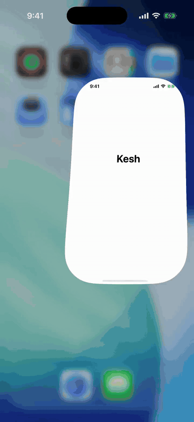
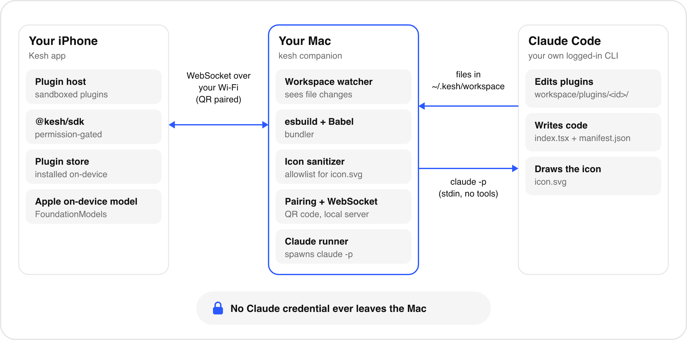
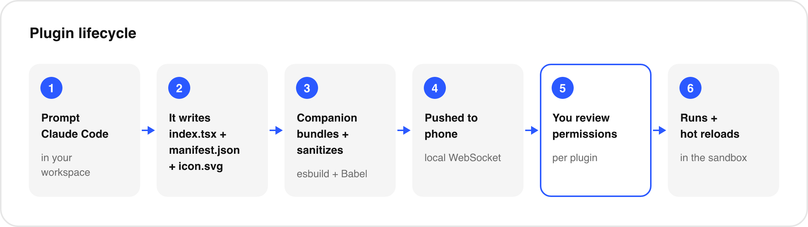
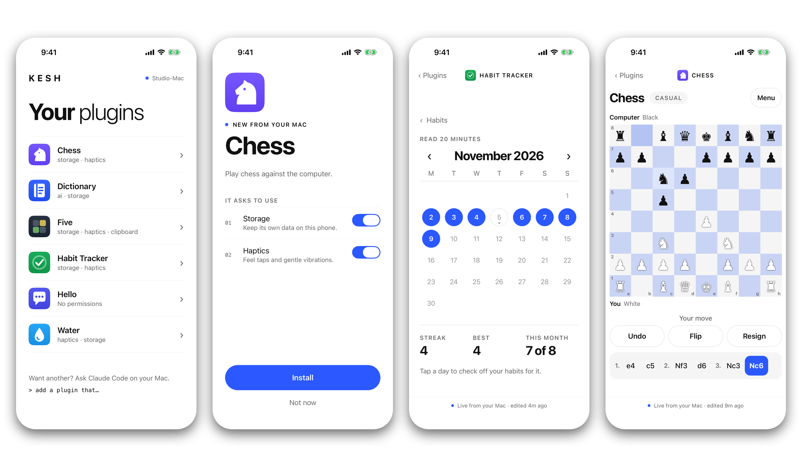
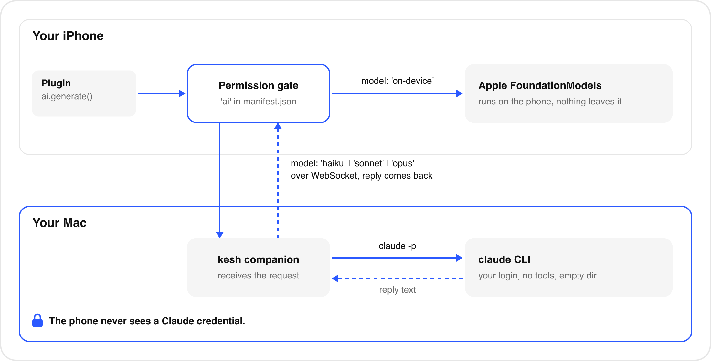
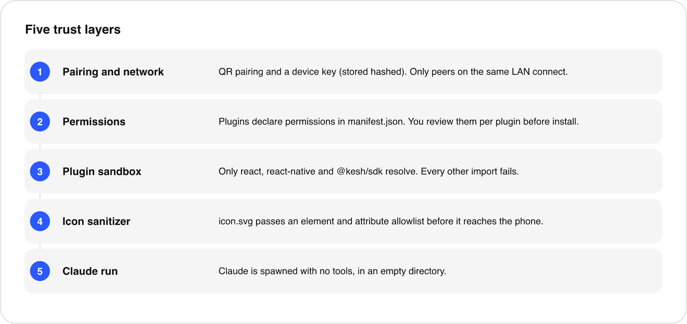

<p align="center">
  <picture>
    <source media="(prefers-color-scheme: dark)" srcset="docs/assets/logo/kesh-logo-dark.svg">
    
  </picture>
</p>

<p align="center"><b>Software that stretches to fit you.</b></p>

<p align="center">
  <a href="LICENSE"></a>
  
  
</p>

Kesh is an iPhone app that runs small apps ("plugins") written by Claude Code on your Mac. You describe a plugin in plain language, Claude writes it into a workspace folder, and a companion process bundles it and pushes it to your phone, where you review and install it. Edits hot-reload on the phone as Claude saves them, so you can shape an app while holding it. Everything runs on your own devices over your own network, using your own Claude Code login.

<p align="center">
  
</p>

## How it works

<p align="center">
  
</p>

The Mac companion watches `~/.kesh/workspace/plugins/`. When Claude Code writes or edits a plugin there, the companion bundles it (esbuild, then a Babel pass for Hermes), sends it over a WebSocket on your Wi-Fi, and the app shows a review screen with the permissions the plugin asks for. After you accept, the plugin is stored on the phone and evaluated by the app's plugin host. Later saves update it in place.

<p align="center">
  
</p>

See [docs/architecture.md](docs/architecture.md) for the details.

## See it in action

<p align="center"></p>

From left: the plugin list with each plugin's own icon, the review screen where you accept a plugin's permissions, a habit tracker with a month calendar, and a chess game against the built-in engine. All four plugins were written by Claude Code from plain-language prompts; their source is in [examples/plugins](examples/plugins).

## Features

- Plugins are plain React Native components (`index.tsx`) with a `manifest.json` and an `icon.svg`. Claude Code writes them from a workspace that ships its own `CLAUDE.md` with the rules.
- Hot reload: each save is rebuilt and pushed; the phone swaps the running plugin.
- Per-plugin permissions (`haptics`, `storage`, `clipboard`, `notifications`, `ai`), reviewed and toggled by you at install time.
- Pairing by scanning a QR code from the terminal, or by typing the `kesh://` URL. The device then reconnects with a stored key.
- AI for plugins: Apple's on-device model, or Claude through the Claude Code already logged in on your Mac. Optional structured output.
- A small design system (`theme`) and a strict icon pipeline (SVG allowlist sanitizer).
- If a build fails, the companion keeps the last good bundle and prints the error. The app also stores the previous installed version of each plugin (there is no rollback screen yet).
- Local only: no server, no account, no analytics in this repository.

## Quick start

Prerequisites: macOS, Xcode 26 or newer, Node 22 or newer, CocoaPods (via Bundler), [Claude Code](https://code.claude.com/docs) installed and logged in (`claude`, then `/login`), and an iPhone or the iOS Simulator. Kesh is not on npm yet, so you run it from source.

```bash
git clone https://github.com/pmzi/Kesh.git
cd Kesh
npm install                      # installs the companion, protocol and sdk packages
npm run companion                # same as: cd packages/companion && npm run dev
```

The companion creates `~/.kesh/workspace/`, prints a QR code and a `kesh://pair?...` URL, then prints `waiting for devices...`. The URL holds a one-time token: do not share it.

In a second terminal, build the app (the app has its own `package.json`, outside the workspaces):

```bash
cd apps/ios
npm install
bundle install && cd ios && bundle exec pod install && cd ..
npm start                        # Metro, leave running
open ios/Kesh.xcworkspace        # then press Run in Xcode
```

- **Simulator:** choose an iPhone simulator and run. The Simulator has no camera: pair by typing the URL (tap "Enter code instead" in the app and paste the `kesh://pair?...` line).
- **Real iPhone, free Apple ID:** in Xcode, select the Kesh target, Signing & Capabilities, tick "Automatically manage signing", pick your personal team and change the bundle identifier (the default `com.pouya.kesh` belongs to the author) to something unique. On the phone enable Developer Mode (Settings, Privacy & Security, Developer Mode, then restart), run from Xcode, then trust the profile (Settings, General, VPN & Device Management). Free signing expires after 7 days: run again from Xcode to renew.
- **Pair:** open Kesh and scan the QR from the terminal (allow Camera and Local Network access), or enter the URL. The Mac and phone must be on the same Wi-Fi.
- **Build something:**

```bash
cd ~/.kesh/workspace && claude
# > add a plugin that tracks how many cups of coffee I drink, with a daily goal
```

When Claude saves the files, the phone shows a review screen. Accept it and the plugin appears on the home screen. A Debug build loads its JavaScript from Metro, so keep Metro reachable from the phone; see [docs/getting-started.md](docs/getting-started.md) for Release builds, details and troubleshooting.

A future `npx kesh` is planned once the package is published. It does not work today.

## Plugins

Six example plugins live in [examples/plugins/](examples/plugins/) (see [examples/README.md](examples/README.md)). Copy a folder into `~/.kesh/workspace/plugins/` to try it.

| | Plugin | What it shows | Permissions |
|---|---|---|---|
|  | [hello](examples/plugins/hello) | Smallest possible plugin: greeting and a tap counter | none |
|  | [water-tracker](examples/plugins/water-tracker) | Progress ring, persistent daily state | haptics, storage |
|  | [habit-tracker](examples/plugins/habit-tracker) | Lists, calendar view, per-day history | storage, haptics |
|  | [five](examples/plugins/five) | A daily five-letter word game with share-to-clipboard | storage, haptics, clipboard |
|  | [chess](examples/plugins/chess) | A complete chess game with its own engine, in several files | storage, haptics |
|  | [dictionary](examples/plugins/dictionary) | `ai.generate` with a schema, model picker, history | ai, storage |

Writing your own: [docs/plugin-authoring.md](docs/plugin-authoring.md).

## The SDK

Plugins import from `react`, `react-native` and `@kesh/sdk`, and nothing else. `@kesh/sdk` is provided by the app at runtime and each module is permission-gated.

| Module | Permission | Summary |
|---|---|---|
| `haptics` | haptics | `impact`, `notification`, `selection` |
| `storage` | storage | String key/value, namespaced per plugin |
| `clipboard` | clipboard | `getString`, `setString` |
| `notifications` | notifications | `schedule`: declared but not implemented, throws |
| `ai` | ai | `models()`, `generate()` with optional schema |
| `theme`, `usePluginInfo` | none | Design tokens; the running plugin's id and name |

Full reference: [docs/sdk.md](docs/sdk.md).

## AI in plugins

<p align="center">
  
</p>

`ai.generate({ model, prompt, system?, schema? })` picks a backend from `model`. `'on-device'` uses Apple's FoundationModels on the phone and needs iOS 26 and Apple Intelligence. Any other value (`'haiku'`, `'sonnet'`, `'opus'` or a model id) goes to the companion, which runs your own `claude` CLI with no tools and no session. The phone never sees a Claude credential. See [docs/ai.md](docs/ai.md).

## Security model

<p align="center">
  
</p>

Pairing needs a one-time token from the Mac's terminal, after which the phone holds a random device key that the Mac stores only as a SHA-256 hash. The companion accepts connections only from private-network addresses. Plugins declare permissions and you review them per plugin; SDK calls without a granted permission throw. Plugin code is evaluated inside the app's JavaScript context with a `require` that resolves only three modules, which is not a hard sandbox: plugins can still reach globals such as `fetch`. Read the full threat model and its limits in [docs/security.md](docs/security.md).

## Status and limitations

Kesh is an early, personal project. Be aware of the following.

- Tested on the iOS Simulator and on one iPhone 15 Pro. Nothing else.
- Not published to npm and not on the App Store or TestFlight. You build the app yourself; free Apple ID signing expires every 7 days.
- Camera QR scanning is implemented and was checked by hand on a real iPhone, but it is not covered by automated tests. You can always type the URL instead.
- Bonjour auto-discovery is not implemented. The companion advertises `_kesh._tcp`, but the app does not browse for it. Pairing is by QR or typed URL, and the URL carries the Mac's IP and port.
- The port changes on every companion start unless you pass `--port`. The phone keeps the old one, so re-pair after restarting.
- `notifications.schedule` is a stub that throws `notifications not implemented yet`.
- On-device AI needs iOS 26 and Apple Intelligence. The app's deployment target is 15.1 and FoundationModels is weak-linked, so the app runs on older systems without it.
- The plugin sandbox is a `require` shim, not isolation. See the security doc.
- Plugins written by an LLM can be wrong or ugly. You review permissions, not code.
- Needs the Mac and phone on one network, and the Mac awake. No remote access.
- Apple and Anthropic policy questions are unresolved for any wider distribution: [docs/policy.md](docs/policy.md).
- iOS only (the React Native project has an `android/` folder from the template, unused).

## Roadmap

Ideas, in rough order, with no dates.

- Bonjour discovery in the app
- Working local notifications
- Launching plugins from widgets and Shortcuts
- App Intents
- A relay for use away from your home network
- Publishing the companion to npm (`npx kesh`)
- TestFlight

## Docs

| Document | Contents |
|---|---|
| [docs/getting-started.md](docs/getting-started.md) | Install, build, signing, pairing, troubleshooting |
| [docs/architecture.md](docs/architecture.md) | Components, protocol, build pipeline, store, hot reload |
| [docs/plugin-authoring.md](docs/plugin-authoring.md) | Writing plugins by hand or with Claude |
| [docs/sdk.md](docs/sdk.md) | `@kesh/sdk` reference |
| [docs/ai.md](docs/ai.md) | On-device and Claude models, schemas, errors, limits |
| [docs/security.md](docs/security.md) | Threat model and what is not protected |
| [docs/policy.md](docs/policy.md) | Apple and Anthropic policy considerations |
| [examples/README.md](examples/README.md) | Example plugins |

## Contributing

Issues and pull requests are welcome. Read [CONTRIBUTING.md](CONTRIBUTING.md) for the repository layout and how to run tests. Report security problems privately, as described in [SECURITY.md](SECURITY.md).

## License

[MIT](LICENSE), copyright (c) 2026 Pouya Mozaffar.
