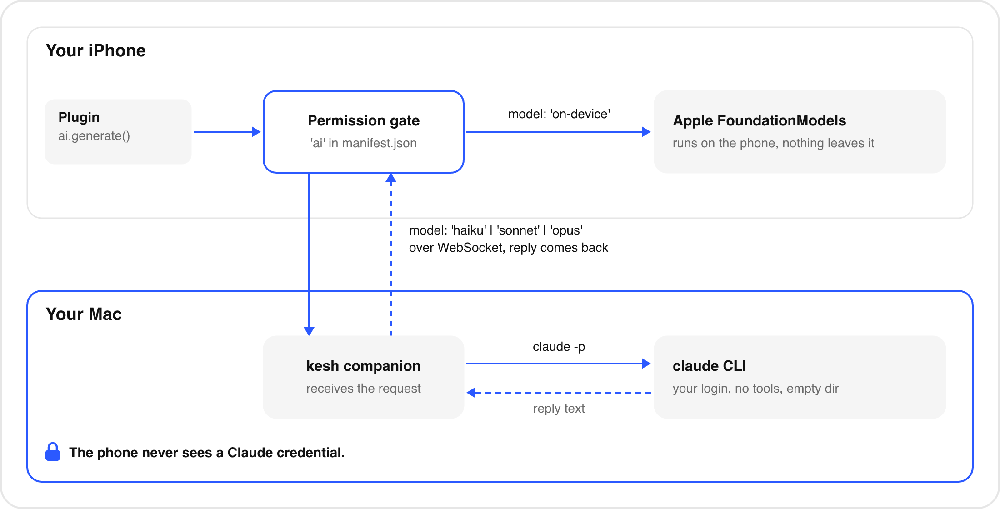

# AI in plugins

<p align="center"></p>

A plugin with the `ai` permission can call `ai.generate`. The `model` field decides where the request runs.

| `model` | Runs on | Needs |
|---|---|---|
| `'on-device'` | The phone, Apple's FoundationModels (`KeshAI.swift`) | iOS 26 and Apple Intelligence enabled, with the model downloaded. |
| `'haiku'`, `'sonnet'`, `'opus'`, or any Claude alias or model id | The Mac: the companion runs your own `claude` CLI | The Mac connected, Claude Code installed and logged in. |

The app's deployment target is iOS 15.1 and FoundationModels is weak-linked, so the app still launches on older systems; there, `ai.models()` reports `onDevice: false` and on-device calls reject with "Requires iOS 26".

## Choosing a model in a plugin

```ts
import { ai } from '@kesh/sdk';

const { onDevice, claude } = await ai.models();
const model = onDevice ? 'on-device' : claude ? 'haiku' : null;
if (!model) { /* tell the user, nicely */ }
```

Default to on-device when available (private and offline), else a Claude model, and let the user choose. The `dictionary` example does this with a picker, and disables choices that are not available.

## Plain text and structured output

```ts
const text = await ai.generate({ model, system: 'Be concise.', prompt: 'Explain "lede".' });

type Entry = { meaning: string; examples: string[] };
const entry = await ai.generate<Entry>({
  model,
  prompt: 'Define "lede" as used in: "Bury the lede."',
  schema: {
    type: 'object',
    properties: {
      meaning: { type: 'string', description: 'One sentence' },
      examples: { type: 'array', items: { type: 'string' }, minItems: 2, maxItems: 2 },
    },
    required: ['meaning', 'examples'],
  },
});
```

The schema is a deliberately small JSON-schema subset: an object whose properties are strings or arrays of strings, with optional `description`, `minItems`, `maxItems` and `required`. Nested objects, numbers, booleans and enums are not supported; use strings and parse them.

How each backend handles a schema:

- **On device:** the schema is converted to a FoundationModels generation schema, so the model is constrained to it. The phone then validates the result again and clamps arrays to `maxItems`.
- **Claude:** the companion passes the schema to `claude` with `--json-schema` and also states it in the system prompt. It extracts and validates the JSON against the schema (known properties only, arrays clamped to `maxItems`, at most 100 items). If the first attempt fails validation it retries once with a corrective note. Optional fields that are absent are omitted.

## Errors

`ai.generate` rejects with an `Error` whose message is readable. Catch it, show it calmly and offer Retry.

| Message | Meaning |
|---|---|
| `Permission "ai" not granted` | Not in the manifest, or switched off. |
| `Your Mac is not connected` / `Your Mac disconnected` | A Claude model needs the companion. Pending requests fail when the socket drops. |
| `Claude took too long to answer` | The phone gave up after 100 seconds. |
| `Timed out` | The companion's 90-second limit for one request was reached. |
| `Claude Code is not installed on this Mac` | `claude` not found (checked: `KESH_CLAUDE_BIN`, `PATH`, `~/.local/bin/claude`). |
| `Not logged in: run claude and /login` | Claude Code is installed but not authenticated. |
| `Claude rate limit: ...` | Usage or rate limit reached on your Claude plan. |
| `Claude failed: ...` | Any other failure, with a short excerpt. |
| `Model did not return valid JSON (...)` | A schema was given and two attempts did not match it. |
| `Response too large` | Over 200 KB. |
| `Too many AI requests in flight; try again shortly` | Queue full. |
| `Plugin has no ai permission` | The companion's manifest check failed. |
| `Invalid ai request: ...` | Bad `model`, empty `prompt`, or limits exceeded. |
| `On-device AI requires iOS 26.` / `Apple Intelligence is not enabled` / `This device does not support Apple Intelligence` / `The on-device model is still downloading` | On-device availability reasons. |
| `Apple's on-device model declined this request (safety guardrails)` | Apple's guardrails refused the prompt. |
| `The prompt is too long for the on-device model` | Context window exceeded. |
| `The on-device model does not support this language` | Unsupported language or locale. |

## Limits

| Limit | Value |
|---|---|
| `prompt` | 1 to 20,000 characters |
| `system` | up to 8,000 characters |
| Schema | at most 12 properties; descriptions up to 1,000 characters; arrays up to 100 items |
| Model name | `^[A-Za-z0-9._:\[\]-]{1,64}$` (`'on-device'` is not accepted by the companion) |
| Claude concurrency | 2 at once, 8 queued |
| Claude timeout | 90 s per request on the Mac; 100 s on the phone |
| Claude response | 200 KB |
| On-device | one call at a time (serialized); prompts and schemas should be short, the model is small |
| Frame size | 1 MB WebSocket frames |

## Privacy and costs

- On-device prompts never leave the phone.
- Claude prompts travel from the phone to the Mac over your LAN (unencrypted, see [security.md](security.md)) and then to Anthropic through your Claude Code, and count against your own Claude plan or usage. Do not put secrets in prompts.
- The Claude process runs with no tools in an empty temporary folder, so a prompt cannot make it read your files.
- The companion logs `ai <plugin> <model> <ms> ok|error` per request, never the prompt or response.

See [policy.md](policy.md) for the policy considerations around running your own `claude` CLI on behalf of an app.
