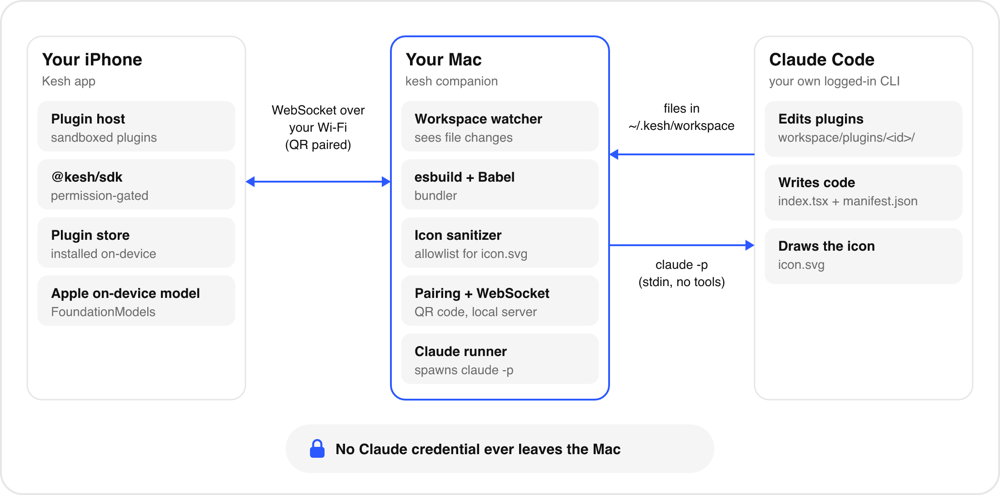
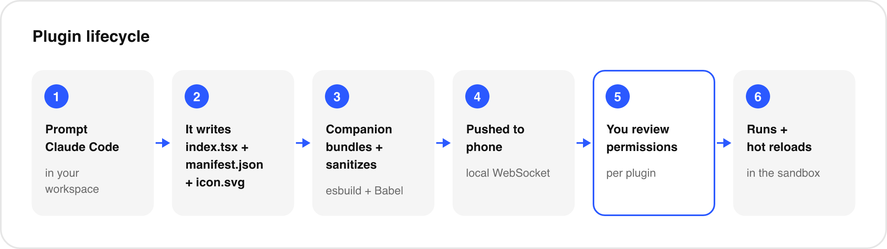

# Architecture

Kesh is two programs and one folder.

| Component | Where | Source | Job |
|---|---|---|---|
| Companion | Mac, Node 22 | `packages/companion` | Watches the workspace, bundles plugins, serves a WebSocket, runs `claude` for AI requests. |
| App | iPhone, React Native 0.88 | `apps/ios` | Pairs, reviews and stores plugins, evaluates them, draws the UI. |
| Protocol | shared types | `packages/protocol/src/index.ts` | The wire format; imported by both sides. |
| SDK | types and workspace template | `packages/sdk` | `@kesh/sdk` type declarations and the `template/` copied into new workspaces. |
| Workspace | `~/.kesh/workspace/` | created by the companion | The folder Claude Code works in. Plugins live in `plugins/<id>/`. |
| Config | `~/.kesh/` | created by the companion | `config.json` (paired devices, hashed keys) and `versions.json` (plugin version counters). |

## Plugin lifecycle

1. Claude Code (or you) writes `plugins/<id>/manifest.json`, `index.tsx` and `icon.svg`.
2. The companion's file watcher (chokidar, 150 ms debounce) sees the change and rebuilds that plugin.
3. A successful build produces a `PluginPayload` (manifest, bundle, optional icon, hash). A failed build is logged as `BUILD ERROR in <id>` and the last good bundle stays in place.
4. If the payload differs from the previous one, it is broadcast to every connected device as a `plugin` message. A newly connected device receives a `snapshot` with all plugins.
5. The app decides whether to show the review screen, apply a silent update, or ignore the push (see Update rules).
6. The app stores the plugin and acknowledges it with an `ack` message. Plugins run inside the app's plugin host.

## Wire protocol

One WebSocket per device at `ws://<host>:<port>/ws`, plain JSON text frames (no TLS). Protocol version is `1` (`PROTOCOL_VERSION`). The server limits frames to 1 MB. A connection must send `hello` within 10 seconds or it is closed. The authoritative definitions are in [packages/protocol/src/index.ts](../packages/protocol/src/index.ts).

Pairing URL: `kesh://pair?host=<ip>&port=<port>&token=<one-time-token>`.

### Phone to companion

| Message | Fields | Meaning |
|---|---|---|
| `hello` | `protocol`, `deviceName`, `token?`, `deviceKey?` | First message. `token` pairs a new device; `deviceKey` reconnects a known one. |
| `ack` | `id`, `version`, `status` (`installed`, `declined`, `error`), `error?` | Result of installing a pushed plugin. |
| `log` | `id`, `level` (`info`, `warn`, `error`), `message` | Runtime log line, printed in the companion terminal. |
| `ai-request` | `requestId`, `pluginId`, `request` (`AiRequest`) | A plugin asked for a Claude model. `on-device` requests never leave the phone. |

### Companion to phone

| Message | Fields | Meaning |
|---|---|---|
| `ready` | `protocol`, `macName`, `deviceKey?`, `claudeAvailable?` | Reply to a valid `hello`. `deviceKey` is present only right after pairing. |
| `snapshot` | `plugins` | Sent right after `ready`: every plugin in the workspace. |
| `plugin` | `plugin` | A plugin was created or rebuilt. |
| `plugin-removed` | `id` | A plugin folder was deleted. |
| `ai-response` | `requestId`, `ok: true`, `result` | Parsed JSON object when a schema was given, otherwise a string. |
| `ai-response` | `requestId`, `ok: false`, `error` | Human-readable error. |
| `error` | `code` (`bad_token`, `bad_device_key`, `bad_protocol`, `bad_message`), `message` | Sent before the socket is closed. |

Companion-side validation uses zod (`packages/companion/src/messages.ts`): malformed or unknown messages from an authenticated device are ignored; before authentication they close the connection.

### Core types

- `PluginManifest`: `id`, `name`, `version` (integer, set by the companion), `description`, `permissions`.
- `PluginPayload`: `manifest`, `bundle` (the body of a CommonJS module), `icon?` (sanitized SVG), `hash` (sha256 of bundle plus icon).
- `Permission`: `haptics`, `storage`, `clipboard`, `notifications`, `ai`.
- `AiRequest`: `model`, `system?`, `prompt`, `schema?`.

## Build pipeline

`packages/companion/src/builder.ts`:

1. Read and validate `manifest.json` with zod. The `id` must be kebab-case and equal the folder name. Permissions must come from the allowed list. A `version` field in the manifest is ignored: the companion assigns it.
2. Bundle `index.tsx` with esbuild: `bundle`, `format: 'cjs'`, `platform: 'neutral'`, `jsx: 'transform'` (classic `React.createElement`), `target: 'es2019'`, with `react`, `react-native` and `@kesh/sdk` marked external. Relative imports (for example chess's `./engine` and `./ai`) are bundled in. Anything else you import that cannot be resolved fails the build.
3. Run the output through Babel's block-scoping transform (`hermes-compat.ts`).
4. Read and sanitize `icon.svg` (see Icons). A bad icon produces a warning, never a failed build.
5. Hash the bundle plus icon, look up the version counter in `versions.json`, and increment it only when the hash changed.

### Why the Babel step exists

Hermes, the JavaScript engine in release builds of the iOS app, shares one binding across loop iterations for `let` and `const` captured by closures. In code like `for (const x of xs) { onPress = () => use(x) }` every closure then sees the last value. esbuild output keeps `let` and `const` (target es2019), so the companion lowers block-scoped bindings to `var` and wraps loop bodies that contain closures in a per-iteration `_loop` function using `@babel/plugin-transform-block-scoping`.

A related Hermes problem is fixed on the phone: esbuild's `__copyProps` helper uses `get: () => from[key]` inside a `for (let key ...)` loop, which on Hermes makes every re-exported getter return the last key. `patchBundle` in `apps/ios/src/plugins/host.tsx` rewrites that getter to capture the key explicitly before evaluating a bundle.

Plugin authors should still prefer `.map` and `.forEach` over loops that create handlers; see [plugin-authoring.md](plugin-authoring.md).

## Plugin host (app side)

`apps/ios/src/plugins/host.tsx` evaluates a bundle with `new Function('module', 'exports', 'require', bundle)`. The `require` passed in resolves `react`, `react-native` and `@kesh/sdk` and throws for anything else. `@kesh/sdk` is created per plugin by `createSdk` with the permissions the user granted, so each SDK call checks its permission and throws `Permission "x" not granted`. The default export is wrapped in a context provider (for `usePluginInfo`) and an error boundary that shows "This plugin stumbled" with a Reload button.

This is a convention-level sandbox, not an isolated runtime. See [security.md](security.md).

## Plugin store

`apps/ios/src/plugins/store.ts` keeps each plugin under the app's Documents directory in `kesh-plugins/<id>/`:

- `current.json`: manifest, granted permissions, bundle, icon, hash, install and update times.
- `previous.json`: the version before the last save. It is written but there is no rollback screen yet.

Plugin data (`storage` module) is separate: AsyncStorage keys `kesh:plugin:<id>:<key>`. Removing a plugin from the home screen (long press) deletes the plugin files; it does not delete its stored data.

## Update and re-review rules

Implemented in `classify()` in `store.ts`:

| Situation | Result |
|---|---|
| Plugin id not installed | Review screen. |
| Pushed manifest asks for any permission the installed manifest did not request | Review screen again. |
| Same hash, same name, description and permissions | Ignored. |
| Anything else (new code, icon, name or description; permissions equal or fewer) | Silent update; the user's earlier grants are kept (intersected with what is requested). The running plugin remounts. |

The user can switch individual permissions off on the review screen; a plugin that calls a denied module gets an error from the SDK. A declined plugin (same id and hash) is not offered again until the app restarts or the plugin changes.

The companion's `version` is informational (shown in logs and `ack`); the app compares hashes, because a manifest-only edit does not change the version.

## Icons

`packages/companion/src/icon.ts` is an allowlist sanitizer. It re-serializes the SVG rather than filtering strings: only allowlisted elements and attributes survive, up to 24 KB, 1000 elements and depth 24. It rejects DTD and entity declarations, CDATA, `javascript:` and `data:`, event handler attributes, `href`, and any `url()` that is not a same-document `#fragment`. The viewBox must be roughly square. The app draws the result with `react-native-svg`, clipped to a rounded square.

## Pairing and reconnect

1. On start the companion creates a random 32-byte token and prints it in the pairing URL and QR code.
2. The phone sends `hello` with `token`. The companion compares it in constant time, clears it (single use), generates a random 32-byte device key, stores only its SHA-256 hash with the device name, and returns the raw key once in `ready`.
3. The phone stores host, port and device key in AsyncStorage and reconnects with `deviceKey` from then on, retrying with exponential backoff up to 15 seconds.
4. The companion also publishes a Bonjour service `_kesh._tcp`, but the app does not browse for it yet.

## AI routing

`ai.generate` runs in `apps/ios/src/sdk/ai.ts`. `model: 'on-device'` calls the native `KeshAI` module (`ios/Kesh/KeshAI.swift`, FoundationModels, iOS 26 and Apple Intelligence). Anything else is sent as `ai-request` to the companion, which validates it and runs `claude -p` through `ClaudeRunner`. Details in [ai.md](ai.md).

## Tests

- `packages/companion/test`: vitest; builder, icon sanitizer, Hermes transform, pairing, AI runner and an integration test over a real WebSocket.
- `apps/ios/__tests__`: jest; store, SDK permission gate, AI client.
- `packages/sdk`: `npm run check` validates template manifests and icons and type-checks the template.
