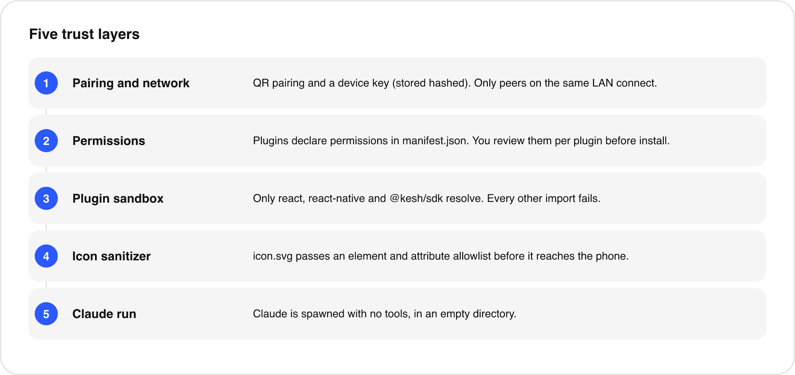

# Security

<p align="center"></p>

Kesh runs code that an AI wrote, on a phone, on your home network. This document states what the code does to limit the damage and, just as important, what it does not do. Kesh is an early personal project and has not had an independent security review.

## Who and what is trusted

| Party | Trust |
|---|---|
| You, on your own Mac and phone | Fully. |
| Claude Code on your Mac | It writes code that will run on your phone. It can be wrong, and it can be misled by content it reads (prompt injection). You review permissions, not code. |
| Plugin code | Not trusted, but only partly contained (see "What is not protected"). |
| Other devices on your LAN | Not trusted. They must not be able to pair or read your plugins. |
| Anyone on the internet | Not able to reach the companion unless you expose the port yourself. Do not. |

## Layer 1: pairing and network

- **One-time token.** The companion creates 32 random bytes at start. The pairing URL and QR code carry it. It is compared in constant time and cleared after the first successful pairing, so a second device needs a companion restart.
- **Device key.** After pairing, the phone gets a random 32-byte key. The companion stores only its SHA-256 hash (`~/.kesh/config.json`, file mode 600) and checks reconnects in constant time. Revoke every device with `kesh unpair` (or by deleting that file).
- **Private peers only.** The server listens on all interfaces but closes any connection whose remote address is not loopback, link-local, `10.0.0.0/8`, `172.16.0.0/12`, `192.168.0.0/16`, or IPv6 loopback, link-local or unique-local. Other HTTP paths return 404. WebSocket upgrades are accepted only on `/ws`.
- **Limits.** 1 MB maximum frame, 10 seconds to send `hello`, schema-validated messages.
- **Pairing URL is a secret** until it is used. Anyone who sees it while it is valid can pair. Do not post it.

Limits of this layer:

- **No encryption.** The connection is plain `ws://`. On a network where someone can observe traffic (an untrusted Wi-Fi, a compromised router), the device key, plugin bundles and AI prompts are visible, and a captured device key can be replayed. Use a network you trust.
- **"Private" means any private range, not "your" network.** A peer on a different private subnet that can route to the Mac passes the check. The check is not a firewall.
- **The phone stores the device key in AsyncStorage**, which is the app's sandboxed storage and not the iOS Keychain.
- Pairing does not show the Mac's identity to the user beyond the Mac's name; there is no key pinning of the server.

## Layer 2: permissions

Plugins declare `permissions` in `manifest.json`: `haptics`, `storage`, `clipboard`, `notifications`, `ai`. On install the review screen lists them with a switch for each, so you can grant a subset. The SDK instance given to the plugin checks the granted list on every call and throws `Permission "x" not granted`. Storage keys are namespaced per plugin.

If an update asks for a permission the installed version did not request, the review screen is shown again. Updates that ask for the same or fewer permissions apply silently, with your earlier grants kept. Silent updates mean new code from your workspace can run without you looking at it again, by design (hot reload). Anyone who can write to `~/.kesh/workspace/plugins/` can therefore change what runs on your phone, within the granted permissions.

The `ai` check also exists on the Mac: an `ai-request` is refused unless the plugin's manifest lists `ai`. That check uses the manifest, not the grants on the phone; the grant is enforced on the phone.

## Layer 3: the plugin "sandbox"

The plugin host evaluates a bundle with `new Function('module', 'exports', 'require', bundle)` and passes a `require` that resolves only `react`, `react-native` and `@kesh/sdk`. Other `require` calls throw. The bundler marks only those three as external; any other import is bundled into the plugin by esbuild if it resolves to JavaScript on disk, or fails the build if it does not. Packages that need native code cannot work.

This is a guard rail, not isolation.

### What is not protected

- **Plugins run in the app's JavaScript context.** `new Function` code sees the global scope. Nothing removes or wraps `fetch`, `XMLHttpRequest`, `WebSocket`, `globalThis`, timers or `eval`. A plugin can make network requests to the internet or your LAN regardless of its declared permissions. The workspace `CLAUDE.md` tells Claude not to use `fetch`, but that is an instruction to a model, not an enforced rule. Restricting or removing these globals in the host is future work.
- **`react-native` is passed through whole.** Anything React Native exposes is reachable, including `Linking` (open URLs and other apps), `NativeModules` (every native module the app registers), `Alert`, `Share`, `Vibration` and `Platform`. A plugin can bypass the SDK's permission gate by calling these directly: for example `NativeModules.KeshAI` for the on-device model, or `Vibration` instead of `haptics`. The permission system is therefore a statement of what a well-behaved plugin does and what the review screen shows, not a security boundary against a malicious plugin.
- **No code review.** The app shows name, description and permissions, not source.
- **Shared process.** A plugin that loops forever or leaks memory can freeze or crash the app. An error boundary catches render errors only.
- **Plugin data is not encrypted** beyond iOS app sandboxing and is not removed when you remove a plugin.
- **Dev builds** include a debug-only (`__DEV__`) remote control: `kesh://dev/...` links and a polled `dev-command.txt` in the app's Documents folder can drive navigation and offer test plugins. It is gated on `__DEV__`, so it is inactive in Release builds.

## Layer 4: icon sanitizer

`icon.svg` comes from a model, is parsed on the Mac, and is rendered on the phone, which makes it an injection surface. The sanitizer parses the XML, rebuilds it from an allowlist of elements and attributes, and rejects entities, DTDs, CDATA, scripts, event handlers, `href`, external or `data:` references, `<use>`, `<image>`, `<style>`, `<foreignObject>` and text elements. Limits: 24 KB, 1000 elements, depth 24. A rejected icon is dropped with a warning and the plugin still installs. The SVG then goes through `react-native-svg`, which does not run scripts. The rules are covered by tests in `packages/companion/test/icon.test.ts`.

## Layer 5: how Claude is run for AI requests

When a plugin calls `ai.generate` with a Claude model, the companion spawns your own `claude` binary with:

```text
claude -p --output-format json --model <model> --tools "" --no-session-persistence
       --disable-slash-commands --strict-mcp-config --system-prompt <text> [--json-schema <schema>]
```

- The prompt goes on stdin, not on the command line; `shell: false`.
- `--tools ""` disables every tool: the model cannot read files, run commands or browse.
- No session is persisted, slash commands and MCP servers are disabled.
- The working directory is a fresh empty temporary folder, deleted afterwards.
- The environment is reduced to `PATH`, `HOME`, `USER`, `LOGNAME`, `LANG`, `TMPDIR` and `CLAUDE_CONFIG_DIR`, just enough for `claude` to find its own login. Other environment variables, such as API keys, are not passed.
- The model name must match `^[A-Za-z0-9._:\[\]-]{1,64}$`; `system` is capped at 8,000 characters and `prompt` at 20,000; schemas at 12 properties.
- At most 2 requests run at once with 8 queued; each has a 90-second timeout; responses over 200 KB are rejected.
- Credentials: the phone never sees any Claude credential, and the companion does not read or transmit your Claude login. `claude` uses its own stored login.

This is separate from the Claude Code session you run in the workspace yourself (`cd ~/.kesh/workspace && claude`), which has whatever tool access you grant it. See the next section.

## Prompt injection and pasted code

- **Claude Code in the workspace has tools.** Treat it as you would any coding agent. If you ask it to read a web page, a README or a pasted snippet that contains hostile instructions, it may write a plugin that does something you did not ask for, for instance a plugin that sends your clipboard to a server. Since plugins can use `fetch` (see above), the permission screen will not show that. Skim generated code before accepting plugins from untrusted material, and be skeptical of plugins that request `clipboard`.
- **Pasted plugins.** Copying a plugin from the internet into `plugins/` is running someone else's code in your app with the limits above. Read it first.
- **AI output is untrusted.** Plugin authors should treat `ai.generate` results as text to display, not as instructions or code. The Mac side validates structured output against the schema and the phone validates again.
- **Never put secrets in prompts.** On-device prompts stay on the phone; Claude prompts go to Anthropic through your Claude Code.

## Reporting a vulnerability

See [../SECURITY.md](../SECURITY.md).

## Summary of known gaps

- Unencrypted transport on the LAN.
- Host does not restrict globals (`fetch`, `WebSocket`, `Linking`, `NativeModules`) in plugins.
- Permission gates can be bypassed by code that uses React Native APIs directly.
- Silent updates without re-review when permissions do not grow.
- Device key kept in AsyncStorage, not the Keychain.
